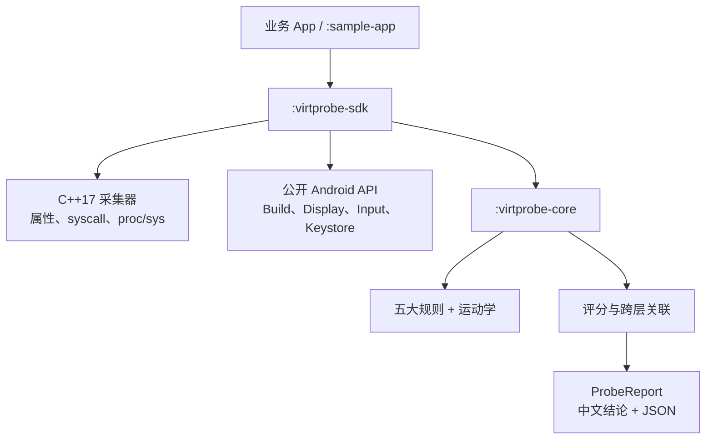

# 虚拟环境探针 android-virt-probe

一站式开源 Android 虚拟环境融合检测 SDK。目标不是把检测藏起来，而是**尽可能多地把「这不像一台真实物理手机」的证据暴露出来**，并给出一份结构化、可解释、可追溯的 `ProbeReport`。

每条命中都回答三件事：

1. **检测到的数据是什么**（`observedDataZh`）
2. **正常真机应该是什么**（`expectedBaselineZh`）
3. **建议怎么处理**（`recommendationZh`）

报告顶部还有一句话结论 `conclusionTitleZh` 和一段总结 `conclusionSummaryZh`。演示应用默认只展开异常项，原始键值收在「查看底层原始证据」里。

协议：Apache-2.0。检测逻辑是本仓库独立编写的，可参考的开源项目和明确没有复制的项目见文末与 `NOTICE`。

## 架构

采集和判定分开。判定不依赖 Android SDK，所以模拟器规则、容器规则、虚拟屏分类、一致性校验、输入设备与运动学都可以在普通 JVM 上用 JUnit 跑通。



| 模块 | 运行环境 | 职责 |
| --- | --- | --- |
| `:virtprobe-core` | 纯 Kotlin JVM | 数据模型、规则、关联、评分、中文结论、JSON |
| `:virtprobe-sdk` | Android Library + C++17/JNI | 采集 Java/原生证据，包装实时输入回调 |
| `:sample-app` | 演示 App | 结论卡片、五维状态、异常优先列表、触控试验区 |

没有 Android SDK 时，Gradle 只会配置 `:virtprobe-core`，单元测试仍然可以运行。装好 SDK 和 NDK 后重新同步，会自动纳入另外两个模块。

## 目录结构

```text
.
├── virtprobe-core/                 纯 JVM 判定
│   └── src/main/kotlin/io/virtprobe/core/
│       ├── model/                  SignalFinding、ProbeReport、快照
│       ├── emulator/               模拟器与虚拟机规则
│       ├── container/              容器与多开规则
│       ├── virtualdisplay/         虚拟屏分类
│       ├── consistency/            跨层一致性
│       ├── input/                  输入设备与运动学
│       ├── correlation/            总判
│       ├── scoring/                风险分
│       ├── report/                 中文结论
│       └── engine/                 ProbeEngine
├── virtprobe-sdk/
│   └── src/main/
│       ├── kotlin/io/virtprobe/sdk/    VirtProbe、采集器、窗口回调
│       └── cpp/                        syscall、属性、proc 解析、JNI
├── sample-app/                     演示界面
├── scripts/test-native.sh          无 NDK 时的 C++ 自测
├── LICENSE
└── NOTICE
```

## 报告里能直接读懂的字段

`SignalFinding` 除了 `signalId`、`category`、`severity`、`confidence`、`detected`、`rawEvidence`、`sourceAttribution`，还有三段中文：

| 字段 | 含义 |
| --- | --- |
| `observedDataZh` | 实际读到的属性、路径、显示器、触控数值 |
| `expectedBaselineZh` | 真实物理手机的对照基线 |
| `recommendationZh` | 可执行建议。未命中时为「该项符合真机基线，无需额外处置。」 |

`ProbeReport` 顶层：

| 字段 | 含义 |
| --- | --- |
| `verdict` | `REAL_DEVICE` / `SUSPICIOUS` / `EMULATOR_OR_VM` / `VIRTUAL_CONTAINER` / `VIRTUALIZED_ENVIRONMENT` |
| `riskScore` | 0 到 100。只累计命中项，多维度互相印证时加分 |
| `conclusionTitleZh` | 例如「高概率运行于虚拟/模拟器环境」或「未发现明显虚拟环境异常」。未命中不能单独证明是真机 |
| `conclusionSummaryZh` | 命中了哪几类，以及当前最该看的建议 |
| `moduleSummaries` | 五个维度的「正常 / 低敏提示 N 项 / 命中 N 项异常 / 未启用」 |

严重级别是 `INFO`、`LOW`、`MEDIUM`、`HIGH`、`CRITICAL`。未命中项会降成 `INFO`，避免「全部项目」里正常项也涂成高危。工作资料（Work profile）造成的非 0 用户只记低敏，不会单独把手机判成容器。

调用 `report.toPrettyJson()` 得到缩进 JSON。

## 五大模块

### 1. 模拟器与虚拟机 `emulator`

| 信号 | 在看什么 |
| --- | --- |
| QEMU 属性 | `ro.kernel.qemu`、`ro.boot.qemu`、AVD 名称。真机上应为空或 `0` |
| 身份字符串 | `ro.hardware`、指纹、`ro.build.characteristics` 里的 goldfish、ranchu、sdk_gphone、vbox、cuttlefish、crosvm、云手机字样 |
| init 服务 | `init.svc.qemu-props`、`qemud`、`goldfish-*`、`vbox86-setup` 是否处于 running |
| 管道与驱动 | `/dev/qemu_pipe`、`/dev/goldfish_pipe`、`/dev/socket/qemud`、`/dev/vboxguest`、`/sys/qemu_trace`，以及夜神、雷电、MuMu、BlueStacks 的残留文件。Java 与 native 都会探 |
| 配套包 | BlueStacks、夜神、逍遥、MuMu、雷电、Genymotion 等包名 |
| 图形 | `GL_RENDERER` 里的 SwiftShader、llvmpipe、virgl、Android Emulator |
| CPU | `/proc/cpuinfo` 的 hypervisor / QEMU / goldfish；`libhoudini`、`libndk_translation` 这类 ARM 转译层 |
| 传感器与电池 | Goldfish 传感器名、加速度恒定值或零噪声、温度和电压同时为 0 |
| 网卡 | 只有以太网、没有 wlan / 蜂窝网时，作为云手机形态的中危信号 |

### 2. 应用内虚拟容器 `container`

| 信号 | 在看什么 |
| --- | --- |
| 数据目录 / APK 路径 | 是否离开 `/data/user/<用户号>/<本包名>` 或 `/data/app`，是否嵌套平行空间、DualSpace、VirtualApp、VirtualXposed、BlackBox、VMOS、360 分身 |
| 用户号 | `uid / 100000 != 0`。工作资料也会这样，单独只算低敏 |
| 同 UID 包名 | `PackageManager.getPackagesForUid`。已知宿主包升为高危，陌生共享 UID 只算中危 |
| 命令行 | `/proc/self/cmdline` 是否还是本包名 |
| maps / mountinfo / environ | 异源 apk、`libva++` / sandhook / blackbox、宿主挂载、`VA_` 一类环境变量 |
| 类加载器与调用栈 | `dexElements` 路径，以及 `com.lody.virtual`、`io.va.exposed`、`de.robv.android.xposed` 等前缀 |

### 3. 虚拟屏幕与投屏 `virtualdisplay`

这一维是按公开 SDK 做的洁净室实现，没有使用 GPL-3.0 的截屏检测项目。

| 信号 | 在看什么 |
| --- | --- |
| 显示器枚举 | `DisplayManager.getDisplays()`。多一块屏可能是扩展坞，名称含 `scrcpy`、`VirtualDisplay`、`overlay`、`miracast`、`cast`、`wifi-display` 才升为高危 |
| 标志位 | `FLAG_PRESENTATION`、`FLAG_PRIVATE`、`FLAG_SECURE` |
| 几何 | 密度、刷新率、分辨率是否出现 0 或明显超出物理面板 |
| 屏幕采集回调 | Android 14（API 34）的 `Activity.ScreenCaptureCallback`。它只通知注册之后的新采集，不能证明注册前没有人在录 |
| AppOp | 本应用自己的 `OPSTR_PROJECT_MEDIA` / `OPSTR_PROJECT_AUDIO`。这不是全系统录屏开关 |
| 路由 | `MediaRouter` 选中的远程路由，以及 `Settings.Global.WIFI_DISPLAY_ON` |

建议文案会明确写成：检测到活跃投屏或虚拟副屏时，对当前页面打开防截屏保护，并提示关闭投屏。

### 4. 硬件一致性 `consistency`

| 信号 | 在看什么 |
| --- | --- |
| Java 与原生属性 | `Build.*` 对比 `__system_property_get`。一边为空不算冲突，避免把读失败当成改机 |
| cpuinfo 两层文本 | Java 文件读取对比 native `openat` |
| 指纹 | 格式是否为 `brand/product/device:version/id/incremental:type/tags`；system / vendor / odm / bootimage 的前三段是否一致 |
| 身份链 | brand、manufacturer、model、device、hardware 是否为空；商业品牌配 goldfish / crosvm 视为冲突 |
| 启动状态 | `ro.boot.verifiedbootstate`、`ro.boot.flash.locked`、`ro.boot.vbmeta.device_state`。读不到不算命中 |
| CPU 与 ABI | `Runtime.availableProcessors()`、`/sys/devices/system/cpu/present`、`/proc/cpuinfo`；ABI 与 `uname` 机器名是否兼容。32 位应用跑在 64 位内核上不算异常 |
| 传感器与电池 | 有没有加速度计；噪声是否像写死的；Java 电池广播和 sysfs 是否差得过多 |
| Keystore / TEE | 密钥是否在安全硬件中，证明扩展里的安全级别和 RootOfTrust（可信根：启动验证状态、设备是否锁定）。生成失败只记录原因 |

TEE 指可信执行环境（Trusted Execution Environment）。RootOfTrust 是密钥证明里描述启动链的结构。

### 5. 输入来源 `input`

静态盘点：

- `InputDevice` 的 name、descriptor、vendorId、productId、isVirtual、isExternal、sources
- 虚拟触摸屏，以及名称中的 `uinput`、`goldfish`、`ranchu`、`virtio`、`scrcpy`、`adb` 相关字样、`vtouch`、`vbox`、`genymotion`、`bluestacks`、`qwerty`
- `vendorId == 0 && productId == 0` 的触屏或鼠标
- 没有物理触摸屏、只剩键鼠
- native 读取 `/proc/bus/input/devices`，检查 `/dev/uinput` 和 `/dev/input/event*`。SELinux 拒绝时写入原始错误，不算命中
- 已启用的无障碍服务。读屏和密码管理器也会启用，所以单独只算低敏
- UiAutomator、Appium、Auto.js、Tasker、按键精灵等自动化包，以及非默认的 `Instrumentation`

实时事件（`InputEventMonitor` + `VirtProbeWindowCallback`）：

- `deviceId <= 0`（含软键盘使用的 `VIRTUAL_KEYBOARD = -1`）或 `isVirtual == true`
- `FLAG_WINDOW_IS_OBSCURED`、`FLAG_WINDOW_IS_PARTIALLY_OBSCURED`
- API 34 起由无障碍改写事件的标志。平台字段名是 `FLAG_IS_ACCESSIBILITY_EVENT`，值为 `0x800`。它在公开 SDK 里曾长期是测试接口，本仓库按这个固定值判断
- `source == 0` / `SOURCE_ANY`、`TOOL_TYPE_UNKNOWN` 这类注入点击
- 滑动窗口：恒定或为零的 pressure / size / touchMajor、零抖动直线、`eventTime == downTime` 的零时长点击、机械等间隔节律

软键盘的 `-1` 设备号只算低敏，不会单独把这次按键说成注入。真实手指的基线是：来自 `isVirtual=false` 的物理触控芯片，并且压力和触控面积会变化。

## 总判怎么来

- 没有中高危：`REAL_DEVICE`。一两项低敏（工作资料、软键盘）仍保持这个结论，总结里会点明
- 有中危，但还不能定性：`SUSPICIOUS`。单独的投屏通常落在这里
- 模拟器高危，或模拟器中危至少 3 条：`EMULATOR_OR_VM`
- 容器高危，或容器中危至少 2 条：`VIRTUAL_CONTAINER`
- 模拟器和容器同时高危，或至少三个维度里出现高危：`VIRTUALIZED_ENVIRONMENT`

## 演示应用怎么读

`:sample-app` 打开后从上到下是：

1. **核心结论卡片**。绿 / 橙 / 红对应真机、可疑、虚拟环境。里面是一句话结论、总结、综合风险分、「重新扫描」和次级的「导出 JSON」。JSON 在对话框里，不铺在首屏。
2. **五个维度状态卡**。显示正常、低敏或命中了几项。点一张就只看这一类，再点一次取消。
3. **仅看异常 / 全部项目**。默认只看异常。没有异常时显示安心说明，而不是一排空白。
4. **输入试验区**。点击、滑动或打字后，立刻显示这次输入的结论、实测数据、真机特征和建议。窗口回调包的是整个窗口，试验区只是最明显的落点。
5. **问题卡片**。每张卡片直接放三段中文。原始键值和许可证归属在「查看底层原始证据」里。

## 接入

```kotlin
val report = VirtProbe.scan(context)
if (report.verdict != EnvironmentVerdict.REAL_DEVICE) {
    show(report.conclusionTitleZh)
}

window.callback = VirtProbeWindowCallback(window.callback) { trace ->
    if (trace.suspicious) rejectCurrentGesture(trace.recommendationZh)
}

val watch = VirtProbe.attachScreenCaptureWatch(activity)
```

Android 14 及以上注册屏幕采集回调需要清单里的普通权限 `android.permission.DETECT_SCREEN_CAPTURE`。SDK 清单已经声明。没授予时注册失败只表示回调没挂上，不会把进程打崩，也不会当成正在投屏。

只扫某几维时用 `VirtProbeConfig`。关掉的维度在报告里是「未启用」，不会被算成通过。

`scanAsync` 的回调在后台线程，更新界面要切回主线程。传感器采样默认最多 200 毫秒，跑在独立线程上，主线程调用也不会和传感器回调互相等待。

## 构建与测试

需要 JDK 17 或更高。本仓库用 Gradle Wrapper。

```bash
./gradlew :virtprobe-core:test
```

有 C++ 编译器但没有 NDK 时，可以验证解析器和 Linux `openat` / `faccessat` / `uname` 采集：

```bash
bash scripts/test-native.sh
```

脚本默认用 `g++`。`__system_property_get` 只在 Android 上编译进去；其它系统返回空字符串，避免在宿主机上伪造属性。

装好 Android SDK 与 NDK 后，在 `local.properties` 写上 `sdk.dir`，或设置 `ANDROID_HOME`。根工程会自动加入 `:virtprobe-sdk` 和 `:sample-app`：

```bash
./gradlew :virtprobe-sdk:assembleDebug :sample-app:assembleDebug
```

`compileSdk` 为 35，`minSdk` 为 24。NDK 使用模块里的 CMake 脚本编译 `libvirtprobe_native`。

也可以强制开关：

```bash
./gradlew :virtprobe-core:test -Pvirtprobe.includeAndroid=false
```

## 开源融合与协议

本项目是 Apache-2.0。

方法上参考了这些兼容许可证项目，但没有复制它们的源码：Detect-Any、RiskEngine、vigil-android、EasyProtector、anti-emulator、android-emulator-detector、conbeerlib。许可证分别是 Apache-2.0 或 MIT，完整说明在 `NOTICE`。

下面三个仓库**只允许用公开 Android API 和通用系统原理做洁净室实现**，本仓库没有复制它们的代码：

- `Huai-Tian/ScreenshotDetector`（GPL-3.0）：投屏/采集检测改走 `DisplayManager`、`Activity.ScreenCaptureCallback`、`AppOpsManager`、`MediaRouter`
- `1193776794/launch`（没有明确 SPDX）：输入溯源全部按 `InputDevice` / `MotionEvent` / `KeyEvent` 独立编写
- `ysrc/AntiVirtualApp`（没有明确 SPDX）：容器检测按多用户目录、procfs 和类加载器独立编写

不依赖 Free-RASP 或任何闭源检测 SDK。

## 已知边界

- 权限被拒绝、属性读不到、Keystore 生成失败，都记在原始证据里，不升级成命中。
- 无障碍服务和额外显示器在真机上合法存在，所以单独出现不会直接变成「模拟器」。
- 屏幕采集回调不能看到注册之前已经开始的录屏。
- `OPSTR_PROJECT_MEDIA` 描述的是本应用自己的投射权限，不是「有没有别的应用正在录屏」。
- Android 11 之后，未在 `<queries>` 里声明的包可能查不到。查不到记为未安装，不算异常。
